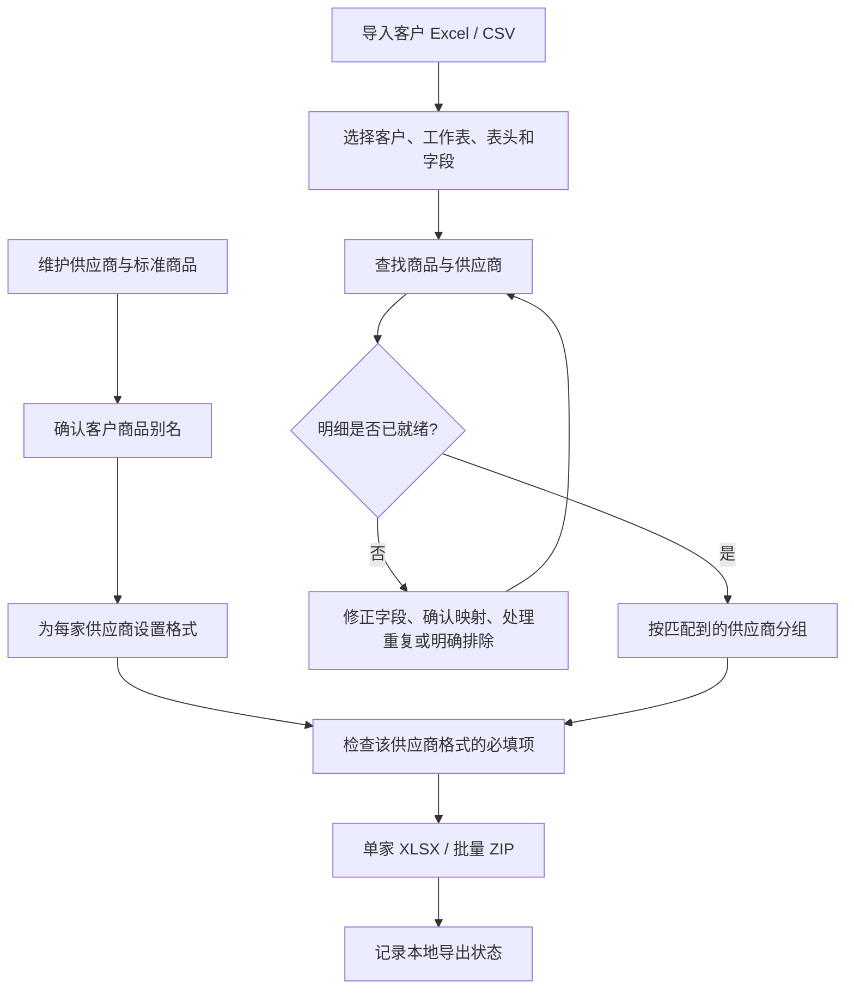

# 序单 OrderFlow 已有功能开发文档

| 项目 | 内容 |
| --- | --- |
| 文档版本 | 1.0 |
| 编写日期 | 2026-10-29（Asia/Shanghai） |
| 对应应用版本 | 网页首版 V1.0，工作区数据版本 `version: 1` |
| 代码基线 | [`6258324`](https://github.com/fengweiheaven/NewShop/commit/6258324c65920d3e91614b3bc349918a54ab10f5) |
| 适用读者 | 接手开发、联调、测试与维护人员 |
| 仓库 | [fengweiheaven/NewShop](https://github.com/fengweiheaven/NewShop) |

本文依据当前仓库中的实际代码编写，描述已完成的三个业务模块、实现规则和现有限制。原始需求中提到的微信群机器人、供应商后台自动提交、物流回单和财务对账尚未接入本版。

## 1. 功能范围与业务流程

系统用于商贸代发业务中的订单整理：先维护商品与供应商关系，再导入不同客户的订单并完成商品匹配，最后按「一家供应商一套格式」输出导单文件。**本版不设统一订单格式**——各供应商要求的列结构不同，统一格式没有实际用途，因此匹配结果直接按供应商落成对方格式，不再经过中间的统一订单快照。

| 模块 | 页面标识 | 当前已实现 |
| --- | --- | --- |
| 商品映射库 | `suppliers` | 供应商维护、报价单导入、标准商品维护、客户名称别名、商品目录导入、样表候选映射确认 |
| 订单采集与匹配 | `import` | 多文件导入、工作表与表头选择、字段对应、商品匹配、异常处理、重复与修订处理、本次批次选择、单条删除与一键清空 |
| 供应商格式 | `export` | 每家供应商一套格式（列名、取值来源、默认值、必填），按匹配到的供应商分组、单家 XLSX 与多家 ZIP 导出 |



未匹配的明细不会进入导出，只会在导出页提示还有多少条待处理；已匹配的明细按供应商一次性生成对方格式的表。当前流程保留逐笔收件明细，不因商品相同而合并订单；商品规格与数量之间没有自动换算。例如一盒包含 30 枚鸡蛋，不会将订单数量 `1` 自动乘为 `30`。

## 2. 技术架构与项目结构

### 2.1 运行架构

系统采用 HTML、CSS、原生 JavaScript 和本地 JSZip 3.10.1，运行时无需安装前端依赖或执行构建。表格解析、商品匹配、工作区保存和文件导出均在浏览器内完成。

当前没有业务后端、HTTP 业务 API、账号体系、服务端数据库、权限角色或跨设备同步。GitHub 仓库用于保存代码；浏览器里的订单和 JSON 备份不会由应用自动提交到仓库。

脚本按以下顺序以 `defer` 加载：

```text
vendor/jszip.min.js → seed.js → core.js → app.js
```

| 文件 | 职责 |
| --- | --- |
| [`dist/index.html`](../dist/index.html) | 页面框架、四模块导航、备份与恢复入口、内容区和弹窗容器 |
| [`dist/style.css`](../dist/style.css) | 基础布局、主题、侧栏、表单和响应式样式 |
| [`dist/extra.css`](../dist/extra.css) | 订单表格、导入区、商品映射、模板设置等业务组件样式 |
| [`dist/seed.js`](../dist/seed.js) | 全局 `OrderSeed`：初始供应商、11 个商品、3 条候选映射及友本模板 |
| [`dist/core.js`](../dist/core.js) | 全局 `OrderExcel`：本地 XLSX / CSV 读取与干净 XLSX 生成 |
| [`dist/app.js`](../dist/app.js) | 四模块交互、业务规则、工作区状态、IndexedDB、导入导出与校验 |
| [`standalone/OrderFlow.html`](../standalone/OrderFlow.html) | 将样式与脚本内嵌的单文件使用版本 |
| [`THIRD_PARTY_NOTICES.md`](../THIRD_PARTY_NOTICES.md) | 第三方组件与许可声明 |

`app.js` 使用闭包保存业务状态；`render()` 根据内存中的 `view` 渲染内容，随后由 `bindView()` 绑定当前页面事件。页面切换不依赖前端框架或 URL 路由。

### 2.2 本地运行

在仓库根目录执行：

```bash
python -m http.server 8765 --directory dist
```

使用现代 Edge 或 Chrome 打开 `http://localhost:8765`。Python 仅提供静态文件，不参与订单计算。

也可以下载 `standalone/OrderFlow.html` 后直接打开。文件来源、浏览器设置和访问地址会影响本地存储及 Web Crypto 的可用性；正式验证建议使用 localhost 或 HTTPS。

当前仓库没有 `package.json`、前端构建脚本或已接入的持续集成流水线。不能直接以 `npm test` 作为本项目的验收命令。

## 3. 工作区与数据模型

### 3.1 持久化方式

| 项目 | 实现 |
| --- | --- |
| IndexedDB 名称 | `orderflow-workbench-v1` |
| 数据库版本 | `1` |
| Object Store | `workspace` |
| 主键 | `state` |
| 写入方式 | 将整个工作区对象深拷贝后写入一个记录 |
| 初始化入口 | `init()` |
| 保存入口 | `save()` |

读取不到有效版本时，使用 `seed()` 建立初始工作区。存储不可用时，界面仍可在内存中继续操作并提示备份；不能将此时的操作视为已持久保存。

```javascript
// 数据结构示意，实际代码仍为原生 JavaScript。
{
  version: 1,
  suppliers: [],
  products: [],
  batches: [],
  activeBatchIds: [],
  orders: [],
  profiles: {},
  unified: null, // 历史字段，保留仅为兼容旧备份
  history: []
}
```

页面、搜索词、页码、筛选项和导入弹窗队列保存在运行时变量中，不属于上述持久化字段。

### 3.2 主要实体

| 实体 | 核心字段 | 说明 |
| --- | --- | --- |
| Supplier | `id, name, contact, phone, note, template, derived` | 每个供应商保存一份当前模板配置；`derived` 表示该供应商来自报价单「按品牌推断」，需人工核对供货主体 |
| Product | `id, internalSku, name, spec, unit, supplierId, supplierSku, aliases`，报价单导入后另有 `brand, category, barcode, groupPrice, cost, broadcastPrice, suggestPrice, marginOwn, marginBroadcast, jdPrice, link, sourceFile` | 每个标准商品关联一个供应商与供应商商品编码；`barcode` 为 69 码，`cost` 为供价/进货价，`groupPrice` 为集采价，`broadcastPrice` 为广电供价，两个 `margin*` 是 0–1 的毛利率 |
| Alias | `customer, name, spec, code` | 空客户表示通用别名；规格可作为精确约束。`code` 的界面能力见第 5 节 |
| Batch | `id, name, hash, customer, createdAt, rowCount?, demo?, exportedAt?` | 一次确认导入建立一个批次；通常对应一个文件里选中的一个工作表 |
| Order | 见下表 | 一条客户订单商品明细，保留原始来源 |
| ExportRow（运行时派生） | 由订单 + 商品 + 供应商即时拼出，不持久化 | 导出取值对象，字段来自 `exportRow()` |
| Profile | 以规范化表头签名为键的字段映射对象 | 字段值为来源列的索引字符串，未读取为 `''` |
| History | `time, action` | 保留最近 50 条通过 `history()` 记录的操作提示，并非完整审计系统 |

订单字段分组：

| 分组 | 字段 |
| --- | --- |
| 标识与客户 | `id, batchId, customer, orderNo, sourceLineId` |
| 来源商品 | `productName, sourceSku, sourceSpec, quantity, unitPrice` |
| 收件信息 | `recipient, phone, address, province, city, district, buyerNickname` |
| 补充信息 | `remark, date` |
| 来源追踪 | `sourceFile, sourceSheet, sourceRow, raw` |
| 处理控制 | `excluded, manual, productId, duplicateOf?, duplicateDiscriminator?, exportedAt?` |

订单状态不作为固定 `status` 字段保存，而是通过 `status(row)` 根据最新商品库、别名和订单字段动态计算。

### 3.3 模板结构

```javascript
{
  name: '供应商模板.xlsx',
  sheetName: 'Sheet1',
  widths: [], // 可选，来自上传模板的列宽
  columns: [
    { header: '订单号', field: 'orderNo', required: false, fallback: '' },
    { header: '商品编码', field: 'supplierSku', required: true, fallback: '' },
    { header: '数量', field: 'quantity', required: true, fallback: '' }
  ]
}
```

模板保存的是列定义与取值规则，不保存上传工作簿的完整二进制内容。

## 4. 模块一：商品映射库

### 4.1 供应商维护

入口函数为 `supplierModal()`，支持新增、修改、删除供应商，编辑名称、联系人、电话和备注。

- 名称必填；按 `norm()` 规范化后的名称检查重复。
- **删除供应商时连带删除其名下商品**：确认框会写明将一并删除多少个商品；确认后移除供应商与其全部商品，并把引用了这些商品的订单明细的 `productId` 清空、`manual` 复位，使其回到「尚未关联商品」而不是悬挂引用。若当前筛选的供应商被删，`supplierFilter` 自动回到「全部」。
- 保存或删除供应商会改变导出分组，导出页需重新打开。
- 页面可直接进入该供应商的模板设置。
- 页面顶部的供应商切换栏由 `supplierRail()` 渲染，每张卡片显示商品数、供价区间与前三个品牌；点击卡片即把 `supplierFilter` 设为该供应商并重绘商品表。这是唯一的供应商切换入口，工具栏里不再放重复的下拉框；卡片上的「编辑」只在悬停或聚焦时出现，并且不会触发切换。

### 4.2 标准商品维护

入口函数为 `productModal()`，可维护商品名称、内部编码、包装规格、计量单位、供应商和供应商商品编码；报价单导入后还可维护 69 码、品牌、商品品类、供价、建议售价、京东价和商品链接。

- **只有商品名称必填。** 内部编码留空时由 `nextProductSku()` 自动生成 `OF-###`；供应商商品编码留空时取内部编码，界面在字段下方给出对应提示。
- 从某家供应商的切换卡片进入本页时，新建商品默认归属该供应商，不需要再手选。
- 内部编码按规范化结果检查重复；同一供应商下的供应商编码按当前字符串检查重复。
- 支持新增通用名称别名、查看和移除已有别名。
- 新增商品时自动建议内部编码，操作者仍可修改；该建议不是独立的编号分配服务。
- 商品编辑、删除及别名变更后，导出结果会随之变化，无需额外操作。

一个标准商品当前只绑定一个供应商。多个上游可供同一商品时，需要维护不同商品记录并人工选择；当前没有库存、价格或优先级驱动的自动供应商路由。

### 4.3 供应商报价单导入

入口函数为 `quoteImport()`，导入按钮位于「商品映射库」右上角。目标是把供应商发来的报价单（一张表里同时含商品、条码、供价和供应商）一次性变成商品映射库数据，而不是逐条手工录入。

导入分为「识别 → 核对 → 写入」三步：

1. 读取工作簿后，用 `OrderExcel.detectHeader()` 定位表头行，再用 `quoteAutoMap()` 按别名表匹配 16 个字段列（`QUOTE_FIELDS`）：商品品类、品牌、69 码、商品名称、商品编码、集采价、供价、广电供价、建议售价、定宣毛利%、广电毛利%、京东价、商品链接、供应商、规格、单位。匹配顺序为完全相等 → 以别名开头 → 包含别名；`norm()` 会去掉空白、换行、括号和标点，因此「供价\n（一件代发）\n所有商品均含税运」能匹配到「供价」。
2. 弹窗显示识别到的列、商品条数与供应商分组，全部可手工改选：可切换工作表、表头行、每个字段对应的列（含「不导入」）。
3. **供应商只从「供应商」列提取**，不做品牌推断。该列为空的行由 `q-fallback` 决定归属：
   - `skip`（默认）：跳过不导入，弹窗与结果提示写明跳过多少行；
   - `manual`：手动输入一个供应商名称（`d.manualName`），空行统一归到该供应商，卡片标记「手动指定」，供应商备注写明来源；
   - `none`：统一归入「未标注供应商」。

   手动模式下输入框边打边更新「将导入的供应商」分组与提交按钮上的数量；名称为空时点导入会就地报错，不会静默落库。
4. 确认后由 `applyQuote()` 写入：同名供应商按 `norm()` 合并；商品按「同供应商 + 同名称 + 同编码」去重，已存在则更新，不存在才新建。

写入规则：

- `supplierSku` 取值优先用 69 码，其次报价单里的商品编码，最后退化为自动生成的内部编码（`OF-###`）。没有条码的商品会带一条待补编码的备注。
- `internalSku` 由 `nextSku()` 生成，并在已用编码集合里去重。
- 价格字段统一经过 `moneyValue()` 清洗（去币符、逗号、千分位），空值保持空字符串，不写 0：`groupPrice` 集采价、`cost` 供价、`broadcastPrice` 广电供价、`suggestPrice` 建议售价、`jdPrice` 京东价。
- 毛利列经 `ratioValue()` 归一化为 0–1 的比例（`0.2` 与 `20%` 都存成 `0.2`），界面用 `percentText()` 还原成百分比。
- 69 码经 `barcodeValue()` 校验，只保留 8–14 位纯数字，`无条码`、`组合装` 等文本视为空。
- 重复导入同一份报价单不会产生重复商品，只会更新已有记录。
- 同一供货商内若 69 码被两个商品复用（例如套装与单瓶共用一个条码），第二个商品的 `supplierSku` 自动改用内部编码，保证「供应商 + 供应商编码」唯一。
- 更新已有商品时，报价单里的空单元格不会清掉商品上已有的值。

### 4.4 商品资料导入

入口函数为 `catalogImport()`：选择供应商、工作表、表头、商品名称列和商品编码列后导入。

- 优先选择名称含“商品编码”的工作表，否则使用首张工作表。
- 缺少名称或编码的行跳过；同供应商已有相同编码的行跳过，不覆盖已有商品。
- 通过名称中的 `数字 + 枚` 尝试提取初始规格；没有通用商品属性解析或单位换算。
- 批量导入的商品以空别名数组创建，随后再确认客户侧叫法。

### 4.5 预置资料

`OrderSeed` 包含友本供应商、11 个标准商品、3 条待确认名称映射，以及 7 列导单模板。初始商品的 `aliases` 为空；候选记录仅用于建议展示，确认前不等于已完成匹配。

| 样表场景 | 确认后对应编码 |
| --- | --- |
| 30 枚儿童 OMEGA-3 营养蛋 | `30101010500045` |
| 30 枚减胆固醇营养蛋 | `30101120200016` |

儿童款与普通 OMEGA-3 款保留不同商品记录。供应商名称来自模板资料，实际供应商主体及供货关系由业务人员核对。

## 5. 模块二：订单采集与匹配

### 5.1 文件与工作表导入

`queueFiles()` 逐个处理选中文件：检查体积、计算完整文件字节的 SHA-256、跳过已导入或待处理队列中的同哈希文件，再调用 `OrderExcel.read()`。

`nextImport()` / `showImportModal()` 负责逐文件确认：

1. 优先选择有数据的工作表，自动建议表头所在行。
2. 根据文件名建议客户名称，可手动修改。
3. 选择一个工作表，调整前 20 行范围内的表头行。
4. 预览前两条原始数据，并确认来源字段对应关系。
5. 确认后读取所选表头下的数据，建立订单及批次。

单次确认只导入所选工作表，不会自动汇总文件的全部工作表。同文件哈希会阻止重复导入，包括试图再次导入其另一张工作表的情况；需要先整理文件或调整批次。

### 5.2 字段识别与清洗

`detectHeader()` 使用订单、商品、数量、收件、地址等关键词对前 20 行评分；`autoMap()` 按预定义同义表头做规范化后的分级匹配：完全相等 > 以别名开头 > 包含别名。单字别名（省、市、区）只接受完全相等，避免把「地址(包含省市区)」这种整段地址吞进省/市/区。两者都是规则方法，不调用 AI 服务。

| 内部字段 | 代表来源表头 |
| --- | --- |
| `orderNo` | 订单编号、订单号、订单编码、订单ID、外部订单号、订单号码 |
| `productName` | 商品名称、产品名称、货品名称、品名、名称、标准商品名、商品标题 |
| `quantity` | 购买数量、商品数量、数量、件数、订购数量、销售数量、采购数量 |
| `recipient` | 收货人/提货人、收货人、收件人、收货姓名、收货人姓名 |
| `phone` | 收货人手机号/提货人手机号、收货电话、收货人电话、手机号、手机、收货人手机、收件人手机、联系方式 |
| `address` | 收货地址/提货地址、收货地址、详细地址、收件地址 |
| `sourceSku` | SKU码、SKU编码、商品编码、商家编码 |
| `sourceLineId` | 订单商品编号、订单明细编号、子订单编号 |
| 其他 | 来源规格、买家昵称、备注、日期、省、市、区、源单价 |

字段方案按整行表头的规范化签名复用，当前不按客户分别保存同一表头签名的多套方案。读取已保存方案时会先用 `autoMap()` 补齐其中的空字段，避免早期存下的空映射（例如当时没识别到「手机」列）继续生效。

导入时至少要求客户名称和商品名称列已指定，其他缺失内容进入明细检查。完全空行、与表头逐列完全相同的重复表头行会跳过。

多数来源值保留为去除首尾空白的字符串；数量会移除英文逗号后转为数值，解析失败置空待处理。日期列若只剩 Excel 序列号（单元格未套日期格式，如 `46293`），由 `excelSerialText()` 还原为 `2026-09-28`。完整地址按“省 + 市 + 区 + 地址”直接拼接，没有自动去重；源地址已含省市区时应避免重复映射这些字段。

`raw` 保存原始列名与对应值，`sourceRow` 保存真实 Excel 行号。原始文件本体不保存在 IndexedDB 中，只保留提取数据、文件名和文件哈希。

兮迪表的“订单商品编号”是订单明细 ID。界面禁止将这一表头对应为 `sourceSku`，避免把每单不同的标识当成稳定商品编码。

### 5.3 商品匹配规则

`norm()` 执行 NFKC、转小写，并去除代码中列出的空白、括号及分隔符。匹配依次考虑人工指定和自动查找：

1. `manual === true` 且存在 `productId` 时，使用人工确认的商品；商品已删除则进入待处理。
2. 自动查找时，规范化来源名称与标准商品名相等可形成候选。来源规格为空、标准规格为空或来源规格不包含“数字 + 枚”时，不施加严格规格相等约束；其余情况要求规格相等。
3. 别名匹配时，非空 `customer` 必须等于当前客户；非空 `spec` 必须等于来源规格。
4. 别名 `code` 非空时比较来源 `sourceSku`；否则比较来源名称与别名名称。
5. 零候选视为未匹配；多个候选进入冲突处理，不自动选择第一项。

**当前界面主要维护名称别名。** 订单确认保存的是“客户 + 名称 + 来源规格”，通用别名仅保存名称，样表候选确认保存“客户 + 完整名称”。这些界面写入的 `code` 都为空。底层虽然保留 `Alias.code` 判断，但没有客户 SKU 别名编辑界面，也不会自动将来源 SKU 与内部编码或供应商编码直接等同。

候选建议由 `suggestion()` 从预置记录中查找；预览建议本身不参与就绪判断。人工确认后，可勾选保存客户名称映射供后续订单复用。

### 5.4 状态与生成门槛

`status(row)` 先检查排除标记，再检查重复标记，最后检查商品和必填数据。

| 状态键 | 含义 | 是否参与导出 |
| --- | --- | --- |
| `excluded` | 操作者明确排除 | 否 |
| `duplicate` | 重复或修订待确认 | 阻止生成 |
| `unmatched` | 无有效商品或有多个匹配候选 | 阻止生成 |
| `invalid` | 商品已定位，但明细字段或供货关联不完整 | 阻止生成 |
| `ready` | 商品唯一、供应商有效且必填内容通过 | 是 |

当前就绪检查要求：商品名非空；数量为有限数值且大于零；收货人、电话、地址非空；唯一商品、有效供应商及供应商商品编码存在。**订单号可以为空**（部分客户表没有该列），空值在导出中保持空白。

电话在导入和手工保存时都会经过 `normalizePhone()`：取出数字后匹配 `1[3-9]` 开头的 11 位手机号，去掉「18466453361-2291」这类分机后缀；匹配不到手机号时保留原文本，避免吞掉座机。

数量没有强制整数约束，电话没有国家地区格式或可达性验证，地址没有行政区划验证。就绪表示通过当前字段规则，不代表已验证真实物流可达性。

### 5.5 防重复与修订处理

当前有两层重复控制：文件 SHA-256 和明细级 `duplicateKey()`。明细键可概括为：

```text
规范化客户
+ 原订单号
+ [来源明细ID，存在时优先；否则使用下列组合]
  客户SKU + 商品名称 + 来源规格 + 收货人 + 电话 + 地址
+ 独立明细区分标识
```

数量与单价不放入回退组合，因此同一明细数量变化可进入版本确认。重复比较范围包括未选中的历史批次，不限于 `activeBatchIds`。只有存在订单号且与未排除记录键相同时，新行才标记 `duplicateOf`；原订单号缺失另由字段检查处理。没有明细 ID 时，收货地址变化会改变回退键，不能保证仍被识别为同一版本。

确认修订时，默认保留本行并排除同键其他版本。若操作者明确勾选“作为独立明细保留”，则生成 `duplicateDiscriminator`，允许两条合法独立明细并存。当前没有自动比对差异、合并版本或撤回供应商订单的功能。

### 5.6 本次批次与历史

`activeBatchIds` 决定本次订单统计、明细列表及导出范围，历史数据仍保留在 `batches` 和 `orders` 中。

- 可在“选择本次批次 / 历史”中勾选本次范围。
- 删除批次同时删除该批次订单，清理相关重复指向；导出结果随之收窄。
- 导出后标记对应订单；一个批次的非排除订单全部有导出标记时，批次被记为已完整导出。
- 下一次导入新批次时，已完整导出的旧批次自动移出本次范围，未完成批次继续保留。
- 导出可重复执行：同一批明细可以多次导出，不会因为第一次导出而消失。

编辑订单行会清除该行的 `exportedAt` 并重算批次标记；商品或供应商资料修改不会批量清除历史订单的导出标记。需要按新资料重新导出旧批次时，应明确将相应历史批次加入本次范围并重新生成。

### 5.7 删除订单数据

删除统一走 `deleteOrders(ids, message)`，三个入口共用同一套清理逻辑，都会先弹确认框：

| 入口 | 位置 | 范围 |
| --- | --- | --- |
| 删除（行内） | 订单明细每行「操作」列 | 单条明细 |
| 删除明细 | 订单核对弹窗底部 | 当前这条明细 |
| 清空订单 | 订单明细卡片右上角，仅在存在订单时出现 | 全部明细与全部批次 |

清理内容：移除订单行；被删除行若是其他行的 `duplicateOf` 目标，同时清除该指向；订单清空后对应的空批次一并移除；`activeBatchIds` 同步收窄；最后写入 IndexedDB 并重绘。删除不支持撤销，界面用 `confirmDialog()` 做二次确认。商品映射库与供应商资料不受影响。

## 6. 模块三：供应商格式与导出

本版取消了统一订单：各供应商要求的列结构不同，中间的统一格式没有实际用途。匹配完成后直接按供应商落成对方格式。

导出页进入即调用 `exportGroups()`：

1. 取 `activeRows()`（本次勾选的批次）中 `status(r).key === 'ready'` 且能定位唯一商品的明细。
2. 用 `exportRow(order, product)` 把订单映射成导出取值对象：`sourceProductName` 保留客户原名称，`productName` 换成标准商品名，并补 `internalSku / spec / unit / supplierId / supplierName / supplierSku`，数量与单价转数值。
3. 按 `product.supplierId` 分桶，一家供应商一组。

因此导出总是基于当前工作区的实时匹配结果，不再维护快照，也不会出现「改了订单但导出的是旧数据」。未匹配的明细不进入导出，页面用 `pendingExportCount()` 提示还有多少条待处理。

导出顺序与列名完全由该供应商的格式决定，不存在应用内置的「统一 20 列」。来源缺少单价时保留空白，本版不计算销售金额、采购金额、利润或账户余额。供应商预览最多 10 行，完整文件包含该组全部明细。

## 7. 模块三（续）：供应商格式配置与拆分导出

### 7.1 格式配置

`templateModal()` 支持上传工作簿，选择工作表及前 20 行内的表头，读取列名、顺序及可用列宽，然后逐列配置：

| 字段 | 含义 |
| --- | --- |
| `header` | 导出列名，必须非空且不重复 |
| `field` | 取自导出取值对象（订单 / 商品 / 供应商字段），或 `constant` / `blank` |
| `fallback` | 原字段缺失时使用的默认值；固定值列直接使用此值 |
| `required` | 导出前是否禁止该列出现空值 |

格式名和工作表名必填。未识别的列默认映射为留空，必须由操作者检查；上传文件包含空白表头列时会阻止直接套用。每家供应商只保存一份当前格式，可在页面顶部切换查看并随时重新设置。

取值由 `templateValue()` 负责：固定值列返回 `fallback`，留空列始终返回空字符串，普通字段为空或不存在时使用 `fallback`。留空列不因设置默认值而改变行为。

`orderNo` 是唯一例外：即使格式里勾了必填，`exportIssues()` 也会跳过它，空订单号不会阻止导出，只在页面用提示条说明「有 N 条明细没有订单号，该列将留空导出」。这与「订单号非必填」的业务规则保持一致。

当前不支持在同一格式编辑器中自由插入、删除或拖动列；需要改变列结构时重新上传具有目标表头的样表。保存后不复制样表原有示例订单、其他工作表或隐藏数据。

### 7.2 友本格式配置

| 顺序 | 输出列 | 来源字段 | 默认必填 |
| --- | --- | --- | --- |
| 1 | 订单号 | `orderNo` | 否 |
| 2 | 买家昵称 | `buyerNickname` | 否 |
| 3 | 收货人 | `recipient` | 是 |
| 4 | 详细地址 | `address` | 是 |
| 5 | 收货人电话 | `phone` | 是 |
| 6 | 商品编码 | `supplierSku` | 是 |
| 7 | 数量 | `quantity` | 是 |

来源未提供买家昵称时默认留空。操作者可以明确改为固定值或取收货人；系统不会默认生成不存在的买家昵称。

### 7.3 分组与导出

`exportGroups()` 直接遍历本次批次里的已匹配明细，按 `product.supplierId` 分桶，不合并相同商品的多条收件明细，也不依赖任何快照。

`exportIssues()` 检查供应商是否设置了格式、各必填输出列是否存在空值。单家可导出 XLSX；批量导出逐家生成 XLSX 后封装 ZIP。供应商预览最多 10 行，完整文件包含该供应商当前的全部已匹配明细。没有格式的供应商会被顶部横幅点名，且该组导出按钮保持禁用，直到设置完成。

文件名使用 Asia/Shanghai 日期，供应商名称中的文件系统保留字符会被替换。ZIP 内附序号避免同名文件相互覆盖。

`exportOne()` / `exportAll()` 在触发浏览器下载后写入 `exportedAt`。该标记只表示应用已发起本地文件下载，不证明用户已保存文件、供应商已接单或后台已导入成功。

## 8. Excel 引擎接口与规则

### 8.1 `OrderExcel` 接口

| 接口 | 输入 | 输出 / 副作用 |
| --- | --- | --- |
| `read(file)` | 有 `name, size, arrayBuffer()` 的浏览器文件对象 | Promise，返回 `{ name, sheets, warnings }` |
| `detectHeader(rows)` | 二维数组 | 返回最可能表头的零基行索引 |
| `buildWorkbook(options)` | `{ headers, rows, sheetName?, widths? }` | Promise，返回 `Uint8Array`，不触发下载 |
| `downloadWorkbook(options)` | 同上并可带 `filename` | 触发 XLSX 下载，并返回生成字节 |
| `downloadBlob(blob, filename)` | Blob 或文件字节与名称 | 通过临时对象 URL 发起下载 |
| `toBase64(data)` / `fromBase64(text)` | 字节 / Base64 | 编码转换 |
| `limits` | 只读对象 | 暴露 `bytes, rows, cols` 限制 |

`sheets` 中的 XLSX 工作表结构为 `{ name, rows, widths, merges }`。CSV 工作表名为 `CSV`，包含 `rows` 和 `widths`；行列数组使用零基索引。

### 8.2 读取行为

- XLSX 使用 JSZip 解包与 DOMParser 解析工作簿关系、共享字符串、行内字符串和单元格缓存值。
- 普通数值保留 XML 中的原始文本，避免 JS Number 进一步舍入订单号、手机号和长编码。原文件若已被 Excel 舍入，程序无法恢复丢失的数字。
- 可识别部分内置和自定义日期格式，并处理 1900 / 1904 日期系统，输出日期字符串；日期按 UTC 计算，不做业务时区转换，纯时间及早期 1900 日期兼容性不宜视为已完整覆盖。
- 公式不执行、不重算，只读取保存的缓存结果；没有缓存时为空，缓存也可能过期。
- 合并单元格仅返回范围引用，不展开被合并区域的值；多行复合表头没有自动拼接能力。
- CSV 支持引号、转义引号和字段内换行；按首行中逗号、制表符、分号的出现情况选择分隔符，不是完整的方言检测。
- 引擎可读取 `.tsv` 及带 BOM 的 UTF-16LE CSV，但页面文件选择入口仅声明 `.xlsx,.csv`；对用户承诺的常规入口为 XLSX / UTF-8 CSV。
- 错误值和公式提示放入 `warnings`。当前业务界面尚未统一展示该数组，不能依赖页面已告知全部读取警告。

### 8.3 输出行为

输出为一张干净工作表，包含固定深色表头、冻结首行、自动筛选和列宽。输出不复刻输入模板的图片、宏、合并、复杂样式、公式、说明区或其他工作表。

订单、电话、编码等标识类表头按文本保存。数量列可写为数值，其他列根据值类型处理；以 `=` 开头的普通字符串仍写为文本，不自动生成公式。自定义模板把标识字段改成无法识别的列名时，仍应将相应值保持为字符串传入引擎。

### 8.4 当前限制

| 层次 | 代码限制 |
| --- | --- |
| 单次订单文件选择 | 最多 30 个文件 |
| 单文件 | 最大 `15 × 1024 × 1024` 字节；空文件拒绝 |
| XLSX 工作表 | 最多 40 张；有效数据超过第 30,000 行拒绝，行号包含表头和前置空行 |
| XLSX 整簿 | 非空行合计最多 30,000 行 |
| CSV | 总行数最多 30,000 行，包含表头 |
| 列数 | 最多 100 列 |
| XLSX 内部 ZIP 文件 | 最多 5,000 项 |
| 单个解压 XML 文本 | 长度不超过 `40 × 1024 × 1024` 个字符 |
| 工作区订单 | 累计最多 30,000 条，历史与已排除行仍占用容量 |
| XLSX 导出 | 最多 30,000 条数据，另加一行表头 |
| JSON 备份恢复 | 文件最大 40 MiB；订单、商品数组分别最多 30,000 条 |

导出与导入行数口径存在边界差异：极限导出 30,000 条数据时会产生 30,001 行，直接再次导入可能触发行号限制。30,000 是代码限值，不代表已经完成该规模的浏览器性能验收。

商品数组的 30,000 条限制位于备份恢复校验中，当前手工新增及目录导入没有同等的累计商品数拦截，不能把这一恢复限制当作所有商品入口都已执行的统一规则。

## 9. 备份、恢复与输入处理

右上角“备份数据”将整个工作区加上 `backupAt` 后导出 JSON，包含业务数据与各供应商格式配置。恢复时确认覆盖当前状态，执行 `validateBackup()` 和必要迁移；导出结果按恢复后的数据即时生成，无需重建快照。

基础校验包括：版本、主要数组与对象类型、各实体字符串 ID 及同类唯一性、商品供应商关系、别名数组、模板列数组、本次批次引用和记录数量。当前不是完整 Schema 校验，不会穷尽所有字段类型、订单批次关系或业务一致性。

界面通过 `esc()` 转义导入值和业务文本，XML 输出做转义并清除部分非法控制字符；工作簿解析拒绝 DTD / ENTITY 声明，不加载外部工作表关系，也不执行文件中的指令文本。

当前没有本地加密、服务端权限控制、跨标签页写入冲突处理或不可篡改日志。更换来源地址、浏览器配置或清理站点数据可能产生独立工作区或移除数据，应通过备份迁移。

## 10. 接手开发与验证

### 10.1 关键函数索引

| 关注点 | 文件与函数 |
| --- | --- |
| 初始化、持久化 | `app.js`: `seed`, `init`, `save`, `migrateScope`, `validateBackup` |
| 字段识别、订单入库 | `app.js`: `queueFiles`, `autoMap`, `showImportModal` |
| 商品匹配、检查 | `app.js`: `norm`, `findProducts`, `suggestion`, `status` |
| 报价单导入 | `app.js`: `quoteImport`, `quoteAutoMap`, `matchColumn`, `quoteRecords`, `quoteGroups`, `quoteSummary`, `applyQuote` |
| 商品映射库视图 | `app.js`: `renderLibrary`, `supplierRail`, `supplierMetrics`, `productsTable`, `bindProductActions` |
| 重复与批次 | `app.js`: `duplicateKey`, `resolveDuplicateChoice`, `activeRows`, `manageBatches`, `deleteOrders` |
| 供应商格式导出 | `app.js`: `exportRow`, `exportGroups`, `pendingExportCount`, `exportIssues`, `exportBytes` |
| 模板与导出 | `app.js`: `templateModal`, `templateValue`, `exportIssues`, `exportBytes`, `exportOne`, `exportAll` |
| 导出状态 | `app.js`: `markExported`, `refreshBatchExportFlags`, `includeNewBatch` |
| 文件引擎 | `core.js`: `read`, `detectHeader`, `buildWorkbook`, `downloadWorkbook` |

`window.OrderFlow.getState()` 返回工作区深拷贝，用于检查；修改返回对象不会写回状态。其他已暴露方法包含 `status`、`summary`、`findProducts`、`validateBackup`、`activeRows` 和 `duplicateKey` 等。它们是当前应用调试入口，不是服务端 API 或稳定的跨应用接口协议。

### 10.2 修改时应保持的约束

1. 修改来源字段时同步检查 `FIELDS`、字段向导与订单结构；导出列名和取值由各供应商的格式配置决定，新增可导出字段时同步 `EXPORT_FIELDS` 与 `exportRow()`。
2. 修改匹配键时保留客户范围与规格语义，避免把订单明细 ID 当商品 ID，或将儿童款与普通款自动合并。
3. 修改订单或映射的路径必须检查快照失效；模板更新应使用已确认快照，不重新读取临时页面内容。
4. 持久化结构变化应设计数据版本和迁移，不能仅更改 JS 对象后假定旧浏览器工作区自动兼容。
5. `standalone/OrderFlow.html` 是独立拷贝，不会随 `dist` 自动同步。修改功能后需同步内嵌资源并验证两种入口；仓库目前没有已提交的自动打包脚本。
6. 不将真实订单文件、收件信息、JSON 工作区备份或私有 QA 数据提交到公开仓库。

### 10.3 已完成的验证及证据范围

首版开发阶段已完成 JavaScript 语法检查、文件引擎离线回归和业务规则回归：

| 验证项 | 已确认结果 |
| --- | --- |
| 两种真实来源格式读取 | 共 6 条明细，字段识别可用 |
| 三条候选名称别名确认 | 儿童 OMEGA-3 编码对应数量 2；减胆固醇编码对应数量 4 |
| 标识保真 | 测试文件中的订单号与电话按文本逐项对照一致 |
| 友本导出 | 7 列顺序正确，6 行明细，总数量 6，不混入原模板示例行 |
| 文件重开 | 导出后由引擎回读，并以独立工具重新打开检查通过 |
| 业务规则 | 本次批次范围、导出标记、旧状态迁移、三个修订版本、独立明细与不同 SKU 的回退重复键通过验证 |
| 报价单导入（真实文件） | 14.2 MiB 报价单在浏览器内 92 ms 读完（157 行 × 13 列，169 个公式只取缓存值）；导入 50 条商品（供应商列有值的行）、跳过 106 条空的，商品总数 11 → 61，孤儿 0、重名 0 |
| 其余列入库 | 广电供价 39.144、建议售价 48.93、定宣毛利 0.279583、广电毛利 0.2、京东价 69.9、链接与 69 码均落到商品上；集采价列在样表中为空，另用指向有值列的方式验证过写入通路（69.9 → `groupPrice`） |
| 报价单重复导入 | 同一文件再导入：新增 0、更新 50，商品总数保持 61 |
| 新建商品 | 只填商品名称即可保存：内部编码自动生成 `OF-012`、供应商商品编码自动同名，供应商取自当前筛选的供应商卡片；表单里只有名称带必填星号 |
| 69码 复用 | 千禾套装与单瓶共用 `6928312916007`，第二个商品自动改用内部编码，全库供应商编码无重复（重复组 0） |
| 供应商格式导出（真实文件） | 导入两份订单并完成映射后，导出页直接分组为「友本 2 条」；无需生成统一订单，点击导出即触发实际下载 |
| 未设置格式的供应商 | 顶部横幅点名「成都定宣商贸有限公司」，该组导出按钮保持禁用；点「设置格式」可直接打开该供应商的格式配置 |
| 供应商切换 | 点击「成都定宣商贸有限公司」得 50 条（2 页），标题计数与卡片选中态一致 |
| 两条入口一致性 | `dist/` 静态站点与重建后的 `standalone/OrderFlow.html` 跑同一套导入用例，结果一致，控制台无报错 |

上述测试脚本及真实样表保留在本地开发工作区，未提交本仓库。因此这些结果是首版交付记录，不代表克隆仓库后已有一套可直接运行的完整自动化测试，也不代表已完成所有浏览器交互、并发、多平台和大容量验收。

### 10.4 建议复核的手工验收用例

| 用例 | 预期 |
| --- | --- |
| 导入不同表头的两个客户文件 | 可分别选择客户与字段，保留来源文件、表、行号 |
| 重复导入同一文件 | 按文件哈希跳过 |
| 同一订单的修订文件 | 待确认；选择新版本后同组旧版本排除 |
| 相似名称同时命中多个商品 | 阻止生成，等待人工选择 |
| 缺订单号、收件信息或数量无效 | 订单号可空并照常生成；缺收件信息或数量无效时保留明细并提示处理，不静默删除 |
| 存在未处理行 | 不能生成；明确排除后不参与输出 |
| 两家供应商混合订单 | 分别生成对应模板文件，ZIP 包含两家文件 |
| 模板增加无法识别列并设为必填 | 必须配置有效来源或固定值后才能导出 |
| 买家昵称缺失 | 友本默认留空；修改映射后按明确规则输出 |
| 导出旧批次后导入新文件 | 已完整导出的旧批次移出本次范围，历史仍可勾选 |
| 修改订单或映射 | 重新打开导出页即反映最新匹配结果 |
| 备份后恢复至另一浏览器 | 恢复基础数据、映射与供应商格式，导出可继续使用 |
| 导入一份含多家供应商的报价单 | 每家供应商生成一张卡片，点击即切换到该供应商的商品 |
| 报价单供应商列部分为空 | 默认跳过这些行并在弹窗提示数量；改为「归入未标注供应商」后才落库 |
| 同一报价单连续导入两次 | 第二次只更新价格，不新增商品 |
| 删除单条订单明细 | 行内「删除」或弹窗「删除明细」，确认后明细与空批次消失 |
| 清空订单 | 右上角「清空订单」确认后明细、批次、统计归零，商品映射库保留 |

## 11. 当前未实现的能力

以下内容不应作为本版已完成功能对外承诺：

- 微信群自动抓单、自动发文件和定时任务。
- 供应商后台接口对接、自动登录、自动提交和接单回执。
- 运单采集、物流匹配与客户原始订单回填运单。
- 客户及供应商资金台账、双向对账、退款或余额计算。
- 客户 SKU 别名的完整维护界面及基于编码的通用映射配置。
- 报价单的供应商只从「供应商」列提取，表头被改写时需要手工指定该列；整列为空时默认整批跳过（可改为归入「未标注供应商」），不做品牌推断。
- 报价单导入不解析多级表头、合并单元格的语义、图片或批注；规格/单位缺列时保持为空。
- 「集采价」「毛利率」等列在样例报价单里大多为空，导入后保持空值，不在界面显示 0。
- 自适应单位换算、多供应商自动择优、库存和缺货分配。
- 完整复刻任意供应商工作簿格式、合并、多级表头和宏。
- 多用户协作、云端同步、服务端权限、完整审计与生产级自动化测试体系。

本版的交付边界是：在浏览器里完成商品关系维护、不同格式订单的人工可核对匹配，以及按每家供应商的列规则直接导出文件；不提供跨供应商的统一订单格式。
