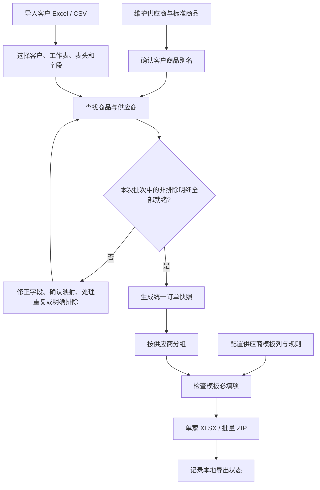

# 序单 OrderFlow 已有功能开发文档

| 项目 | 内容 |
| --- | --- |
| 文档版本 | 1.0 |
| 编写日期 | 2026-10-29（Asia/Shanghai） |
| 对应应用版本 | 网页首版 V1.0，工作区数据版本 `version: 1` |
| 代码基线 | [`6258324`](https://github.com/fengweiheaven/NewShop/commit/6258324c65920d3e91614b3bc349918a54ab10f5) |
| 适用读者 | 接手开发、联调、测试与维护人员 |
| 仓库 | [fengweiheaven/NewShop](https://github.com/fengweiheaven/NewShop) |

本文依据当前仓库中的实际代码编写，描述已完成的四个业务模块、实现规则和现有限制。原始需求中提到的微信群机器人、供应商后台自动提交、物流回单和财务对账尚未接入本版。

## 1. 功能范围与业务流程

系统用于商贸代发业务中的订单整理：先维护商品与供应商关系，再导入不同客户的订单，将有效明细整理为统一订单，最后按供应商生成不同列结构的导单文件。

| 模块 | 页面标识 | 当前已实现 |
| --- | --- | --- |
| 商品映射库 | `suppliers` | 供应商维护、标准商品维护、客户名称别名、商品目录导入、样表候选映射确认 |
| 订单采集与匹配 | `import` | 多文件导入、工作表与表头选择、字段对应、商品匹配、异常处理、重复与修订处理、本次批次选择 |
| 统一订单 | `unified` | 全量有效性检查、生成标准明细快照、预览和下载 XLSX |
| 供应商模板 | `export` | 按供应商拆分、上传模板表头、配置取值规则、单家 XLSX 与多家 ZIP 导出 |



当前流程保留逐笔收件明细，不因商品相同而合并订单；商品规格与数量之间没有自动换算。例如一盒包含 30 枚鸡蛋，不会将订单数量 `1` 自动乘为 `30`。

## 2. 技术架构与项目结构

### 2.1 运行架构

系统采用 HTML、CSS、原生 JavaScript 和本地 JSZip 3.10.1，运行时无需安装前端依赖或执行构建。表格解析、商品匹配、工作区保存和文件导出均在浏览器内完成。

当前没有业务后端、HTTP 业务 API、账号体系、服务端数据库、权限角色或跨设备同步。GitHub 仓库用于保存代码；浏览器里的订单和 JSON 备份不会由应用自动提交到仓库。

脚本按以下顺序以 `defer` 加载：

```text
vendor/jszip.min.js → seed.js → core.js → app.js
```

| 文件 | 职责 |
| --- | --- |
| [`dist/index.html`](../dist/index.html) | 页面框架、四模块导航、备份与恢复入口、内容区和弹窗容器 |
| [`dist/style.css`](../dist/style.css) | 基础布局、主题、侧栏、表单和响应式样式 |
| [`dist/extra.css`](../dist/extra.css) | 订单表格、导入区、商品映射、模板设置等业务组件样式 |
| [`dist/seed.js`](../dist/seed.js) | 全局 `OrderSeed`：初始供应商、11 个商品、3 条候选映射及友本模板 |
| [`dist/core.js`](../dist/core.js) | 全局 `OrderExcel`：本地 XLSX / CSV 读取与干净 XLSX 生成 |
| [`dist/app.js`](../dist/app.js) | 四模块交互、业务规则、工作区状态、IndexedDB、导入导出与校验 |
| [`standalone/OrderFlow.html`](../standalone/OrderFlow.html) | 将样式与脚本内嵌的单文件使用版本 |
| [`THIRD_PARTY_NOTICES.md`](../THIRD_PARTY_NOTICES.md) | 第三方组件与许可声明 |

`app.js` 使用闭包保存业务状态；`render()` 根据内存中的 `view` 渲染内容，随后由 `bindView()` 绑定当前页面事件。页面切换不依赖前端框架或 URL 路由。

### 2.2 本地运行

在仓库根目录执行：

```bash
python -m http.server 8765 --directory dist
```

使用现代 Edge 或 Chrome 打开 `http://localhost:8765`。Python 仅提供静态文件，不参与订单计算。

也可以下载 `standalone/OrderFlow.html` 后直接打开。文件来源、浏览器设置和访问地址会影响本地存储及 Web Crypto 的可用性；正式验证建议使用 localhost 或 HTTPS。

当前仓库没有 `package.json`、前端构建脚本或已接入的持续集成流水线。不能直接以 `npm test` 作为本项目的验收命令。

## 3. 工作区与数据模型

### 3.1 持久化方式

| 项目 | 实现 |
| --- | --- |
| IndexedDB 名称 | `orderflow-workbench-v1` |
| 数据库版本 | `1` |
| Object Store | `workspace` |
| 主键 | `state` |
| 写入方式 | 将整个工作区对象深拷贝后写入一个记录 |
| 初始化入口 | `init()` |
| 保存入口 | `save()` |

读取不到有效版本时，使用 `seed()` 建立初始工作区。存储不可用时，界面仍可在内存中继续操作并提示备份；不能将此时的操作视为已持久保存。

```javascript
// 数据结构示意，实际代码仍为原生 JavaScript。
{
  version: 1,
  suppliers: [],
  products: [],
  batches: [],
  activeBatchIds: [],
  orders: [],
  profiles: {},
  unified: null,
  history: []
}
```

页面、搜索词、页码、筛选项和导入弹窗队列保存在运行时变量中，不属于上述持久化字段。

### 3.2 主要实体

| 实体 | 核心字段 | 说明 |
| --- | --- | --- |
| Supplier | `id, name, contact, phone, note, template` | 每个供应商保存一份当前模板配置 |
| Product | `id, internalSku, name, spec, unit, supplierId, supplierSku, aliases` | 每个标准商品关联一个供应商与供应商商品编码 |
| Alias | `customer, name, spec, code` | 空客户表示通用别名；规格可作为精确约束。`code` 的界面能力见第 5 节 |
| Batch | `id, name, hash, customer, createdAt, rowCount?, demo?, exportedAt?` | 一次确认导入建立一个批次；通常对应一个文件里选中的一个工作表 |
| Order | 见下表 | 一条客户订单商品明细，保留原始来源 |
| Unified | `createdAt, batchIds, rows` | 已核对有效明细的深拷贝快照 |
| Profile | 以规范化表头签名为键的字段映射对象 | 字段值为来源列的索引字符串，未读取为 `''` |
| History | `time, action` | 保留最近 50 条通过 `history()` 记录的操作提示，并非完整审计系统 |

订单字段分组：

| 分组 | 字段 |
| --- | --- |
| 标识与客户 | `id, batchId, customer, orderNo, sourceLineId` |
| 来源商品 | `productName, sourceSku, sourceSpec, quantity, unitPrice` |
| 收件信息 | `recipient, phone, address, province, city, district, buyerNickname` |
| 补充信息 | `remark, date` |
| 来源追踪 | `sourceFile, sourceSheet, sourceRow, raw` |
| 处理控制 | `excluded, manual, productId, duplicateOf?, duplicateDiscriminator?, exportedAt?` |

订单状态不作为固定 `status` 字段保存，而是通过 `status(row)` 根据最新商品库、别名和订单字段动态计算。

### 3.3 模板结构

```javascript
{
  name: '供应商模板.xlsx',
  sheetName: 'Sheet1',
  widths: [], // 可选，来自上传模板的列宽
  columns: [
    { header: '订单号', field: 'orderNo', required: true, fallback: '' },
    { header: '商品编码', field: 'supplierSku', required: true, fallback: '' },
    { header: '数量', field: 'quantity', required: true, fallback: '' }
  ]
}
```

模板保存的是列定义与取值规则，不保存上传工作簿的完整二进制内容。

## 4. 模块一：商品映射库

### 4.1 供应商维护

入口函数为 `supplierModal()`，支持新增、修改、删除供应商，编辑名称、联系人、电话和备注。

- 名称必填；按 `norm()` 规范化后的名称检查重复。
- 仍有关联商品的供应商不可直接删除，需先调整或删除商品。
- 保存或删除供应商会使已生成的统一订单失效。
- 页面可直接进入该供应商的模板设置。

### 4.2 标准商品维护

入口函数为 `productModal()`，可维护商品名称、内部编码、包装规格、计量单位、供应商和供应商商品编码。

- 商品名称、内部编码、供应商商品编码必填。
- 内部编码按规范化结果检查重复；同一供应商下的供应商编码按当前字符串检查重复。
- 支持新增通用名称别名、查看和移除已有别名。
- 新增商品时自动建议内部编码，操作者仍可修改；该建议不是独立的编号分配服务。
- 商品编辑、删除及别名变更后，需重新生成统一订单。

一个标准商品当前只绑定一个供应商。多个上游可供同一商品时，需要维护不同商品记录并人工选择；当前没有库存、价格或优先级驱动的自动供应商路由。

### 4.3 商品资料导入

入口函数为 `catalogImport()`：选择供应商、工作表、表头、商品名称列和商品编码列后导入。

- 优先选择名称含“商品编码”的工作表，否则使用首张工作表。
- 缺少名称或编码的行跳过；同供应商已有相同编码的行跳过，不覆盖已有商品。
- 通过名称中的 `数字 + 枚` 尝试提取初始规格；没有通用商品属性解析或单位换算。
- 批量导入的商品以空别名数组创建，随后再确认客户侧叫法。

### 4.4 预置资料

`OrderSeed` 包含友本供应商、11 个标准商品、3 条待确认名称映射，以及 7 列导单模板。初始商品的 `aliases` 为空；候选记录仅用于建议展示，确认前不等于已完成匹配。

| 样表场景 | 确认后对应编码 |
| --- | --- |
| 30 枚儿童 OMEGA-3 营养蛋 | `30101010500045` |
| 30 枚减胆固醇营养蛋 | `30101120200016` |

儿童款与普通 OMEGA-3 款保留不同商品记录。供应商名称来自模板资料，实际供应商主体及供货关系由业务人员核对。

## 5. 模块二：订单采集与匹配

### 5.1 文件与工作表导入

`queueFiles()` 逐个处理选中文件：检查体积、计算完整文件字节的 SHA-256、跳过已导入或待处理队列中的同哈希文件，再调用 `OrderExcel.read()`。

`nextImport()` / `showImportModal()` 负责逐文件确认：

1. 优先选择有数据的工作表，自动建议表头所在行。
2. 根据文件名建议客户名称，可手动修改。
3. 选择一个工作表，调整前 20 行范围内的表头行。
4. 预览前两条原始数据，并确认来源字段对应关系。
5. 确认后读取所选表头下的数据，建立订单及批次。

单次确认只导入所选工作表，不会自动汇总文件的全部工作表。同文件哈希会阻止重复导入，包括试图再次导入其另一张工作表的情况；需要先整理文件或调整批次。

### 5.2 字段识别与清洗

`detectHeader()` 使用订单、商品、数量、收件、地址等关键词对前 20 行评分；`autoMap()` 按预定义同义表头进行规范化后的精确比较。它们是规则方法，不调用 AI 服务。

| 内部字段 | 代表来源表头 |
| --- | --- |
| `orderNo` | 订单编号、订单号、订单编码、订单ID、外部订单号 |
| `productName` | 商品名称、产品名称、货品名称、品名、名称 |
| `quantity` | 购买数量、商品数量、数量、件数、订购数量 |
| `recipient` | 收货人/提货人、收货人、收件人、收货姓名 |
| `phone` | 收货人手机号/提货人手机号、收货电话、收货人电话、手机号 |
| `address` | 收货地址/提货地址、收货地址、详细地址、收件地址 |
| `sourceSku` | SKU码、SKU编码、商品编码、商家编码 |
| `sourceLineId` | 订单商品编号、订单明细编号、子订单编号 |
| 其他 | 来源规格、买家昵称、备注、日期、省、市、区、源单价 |

字段方案按整行表头的规范化签名复用，当前不按客户分别保存同一表头签名的多套方案。

导入时至少要求客户名称和商品名称列已指定，其他缺失内容进入明细检查。完全空行、与表头逐列完全相同的重复表头行会跳过。

多数来源值保留为去除首尾空白的字符串；数量会移除英文逗号后转为数值，解析失败置空待处理。完整地址按“省 + 市 + 区 + 地址”直接拼接，没有自动去重；源地址已含省市区时应避免重复映射这些字段。

`raw` 保存原始列名与对应值，`sourceRow` 保存真实 Excel 行号。原始文件本体不保存在 IndexedDB 中，只保留提取数据、文件名和文件哈希。

兮迪表的“订单商品编号”是订单明细 ID。界面禁止将这一表头对应为 `sourceSku`，避免把每单不同的标识当成稳定商品编码。

### 5.3 商品匹配规则

`norm()` 执行 NFKC、转小写，并去除代码中列出的空白、括号及分隔符。匹配依次考虑人工指定和自动查找：

1. `manual === true` 且存在 `productId` 时，使用人工确认的商品；商品已删除则进入待处理。
2. 自动查找时，规范化来源名称与标准商品名相等可形成候选。来源规格为空、标准规格为空或来源规格不包含“数字 + 枚”时，不施加严格规格相等约束；其余情况要求规格相等。
3. 别名匹配时，非空 `customer` 必须等于当前客户；非空 `spec` 必须等于来源规格。
4. 别名 `code` 非空时比较来源 `sourceSku`；否则比较来源名称与别名名称。
5. 零候选视为未匹配；多个候选进入冲突处理，不自动选择第一项。

**当前界面主要维护名称别名。** 订单确认保存的是“客户 + 名称 + 来源规格”，通用别名仅保存名称，样表候选确认保存“客户 + 完整名称”。这些界面写入的 `code` 都为空。底层虽然保留 `Alias.code` 判断，但没有客户 SKU 别名编辑界面，也不会自动将来源 SKU 与内部编码或供应商编码直接等同。

候选建议由 `suggestion()` 从预置记录中查找；预览建议本身不参与就绪判断。人工确认后，可勾选保存客户名称映射供后续订单复用。

### 5.4 状态与生成门槛

`status(row)` 先检查排除标记，再检查重复标记，最后检查商品和必填数据。

| 状态键 | 含义 | 是否参与统一订单 |
| --- | --- | --- |
| `excluded` | 操作者明确排除 | 否 |
| `duplicate` | 重复或修订待确认 | 阻止生成 |
| `unmatched` | 无有效商品或有多个匹配候选 | 阻止生成 |
| `invalid` | 商品已定位，但明细字段或供货关联不完整 | 阻止生成 |
| `ready` | 商品唯一、供应商有效且必填内容通过 | 是 |

当前就绪检查要求：订单号和商品名非空；数量为有限数值且大于零；收货人、电话、地址非空；唯一商品、有效供应商及供应商商品编码存在。

数量没有强制整数约束，电话没有国家地区格式或可达性验证，地址没有行政区划验证。就绪表示通过当前字段规则，不代表已验证真实物流可达性。

### 5.5 防重复与修订处理

当前有两层重复控制：文件 SHA-256 和明细级 `duplicateKey()`。明细键可概括为：

```text
规范化客户
+ 原订单号
+ [来源明细ID，存在时优先；否则使用下列组合]
  客户SKU + 商品名称 + 来源规格 + 收货人 + 电话 + 地址
+ 独立明细区分标识
```

数量与单价不放入回退组合，因此同一明细数量变化可进入版本确认。重复比较范围包括未选中的历史批次，不限于 `activeBatchIds`。只有存在订单号且与未排除记录键相同时，新行才标记 `duplicateOf`；原订单号缺失另由字段检查处理。没有明细 ID 时，收货地址变化会改变回退键，不能保证仍被识别为同一版本。

确认修订时，默认保留本行并排除同键其他版本。若操作者明确勾选“作为独立明细保留”，则生成 `duplicateDiscriminator`，允许两条合法独立明细并存。当前没有自动比对差异、合并版本或撤回供应商订单的功能。

### 5.6 本次批次与历史

`activeBatchIds` 决定本次订单统计、明细列表及统一订单生成范围，历史数据仍保留在 `batches` 和 `orders` 中。

- 可在“选择本次批次 / 历史”中勾选本次范围。
- 删除批次同时删除该批次订单，清理相关重复指向并使统一订单失效。
- 导出后标记对应订单；一个批次的非排除订单全部有导出标记时，批次被记为已完整导出。
- 下一次导入新批次时，已完整导出的旧批次自动移出本次范围，未完成批次继续保留。
- 当前统一订单快照允许再次下载，不会因为第一次导出而自动销毁。

编辑订单行会清除该行的 `exportedAt` 并重算批次标记；商品或供应商资料修改不会批量清除历史订单的导出标记。需要按新资料重新导出旧批次时，应明确将相应历史批次加入本次范围并重新生成。

## 6. 模块三：统一订单

`generateUnified()` 要求本次至少存在一条 `ready` 明细，且所有未排除明细均为 `ready`，通过后才生成 `state.unified`。

生成时深拷贝订单，保留来源名称为 `sourceProductName`，将 `productName` 替换为标准商品名称，并补充内部编码、标准规格、供应商 ID / 名称及供应商商品编码。

下载列顺序由 `UNIFIED` 定义，共 20 列：

```text
订单号、客户、来源商品名称、统一商品名称、内部编码、供应商、
供应商商品编码、标准规格、数量、收货人、收货电话、详细地址、
买家昵称、备注、下单时间、客户商品编码、源单价、来源文件、
来源工作表、原始行号
```

来源缺少单价时保留空白。本版不计算销售金额、采购金额、利润或账户余额。

订单列表每页 30 行；统一订单页最多预览 100 行，下载包含全部快照明细。

修改订单、商品、供应商、别名、导入数据、批次范围或恢复备份会通过 `invalidate()` 清空快照，需重新生成。修改供应商模板只影响输出列配置，不会清空统一订单；记录导出状态也保留当前快照。

## 7. 模块四：供应商模板与拆单导出

### 7.1 模板配置

`templateModal()` 支持上传工作簿，选择工作表及前 20 行内的表头，读取列名、顺序及可用列宽，然后逐列配置：

| 字段 | 含义 |
| --- | --- |
| `header` | 导出列名，必须非空且不重复 |
| `field` | 来自统一订单的字段，或 `constant` / `blank` |
| `fallback` | 原字段缺失时使用的默认值；固定值列直接使用此值 |
| `required` | 导出前是否禁止该列出现空值 |

模板名和工作表名必填。未识别的列默认映射为留空，必须由操作者检查；上传文件包含空白表头列时会阻止直接套用。

取值由 `templateValue()` 负责：固定值列返回 `fallback`，留空列始终返回空字符串，普通字段为空或不存在时使用 `fallback`。留空列不因设置默认值而改变行为。

当前不支持在同一模板编辑器中自由插入、删除或拖动列；需要改变列结构时重新上传具有目标表头的模板。保存后不复制模板原有示例订单、其他工作表或隐藏数据。

### 7.2 友本模板配置

| 顺序 | 输出列 | 来源字段 | 默认必填 |
| --- | --- | --- | --- |
| 1 | 订单号 | `orderNo` | 是 |
| 2 | 买家昵称 | `buyerNickname` | 否 |
| 3 | 收货人 | `recipient` | 是 |
| 4 | 详细地址 | `address` | 是 |
| 5 | 收货人电话 | `phone` | 是 |
| 6 | 商品编码 | `supplierSku` | 是 |
| 7 | 数量 | `quantity` | 是 |

来源未提供买家昵称时默认留空。操作者可以明确改为固定值或取收货人；系统不会默认生成不存在的买家昵称。

### 7.3 分组与导出

`exportGroups()` 从已生成的快照按 `supplierId` 分组，不重新采集当前页面表格，也不合并相同商品的多条收件明细。

`exportIssues()` 检查供应商是否配置模板、各必填输出列是否存在空值。单家可导出 XLSX；批量导出逐家生成 XLSX 后封装 ZIP。供应商模板最多预览 10 行，完整文件包含该供应商的全部快照明细。

文件名使用 Asia/Shanghai 日期，供应商名称中的文件系统保留字符会被替换。ZIP 内附序号避免同名文件相互覆盖。

`exportOne()` / `exportAll()` 在触发浏览器下载后写入 `exportedAt`。该标记只表示应用已发起本地文件下载，不证明用户已保存文件、供应商已接单或后台已导入成功。

## 8. Excel 引擎接口与规则

### 8.1 `OrderExcel` 接口

| 接口 | 输入 | 输出 / 副作用 |
| --- | --- | --- |
| `read(file)` | 有 `name, size, arrayBuffer()` 的浏览器文件对象 | Promise，返回 `{ name, sheets, warnings }` |
| `detectHeader(rows)` | 二维数组 | 返回最可能表头的零基行索引 |
| `buildWorkbook(options)` | `{ headers, rows, sheetName?, widths? }` | Promise，返回 `Uint8Array`，不触发下载 |
| `downloadWorkbook(options)` | 同上并可带 `filename` | 触发 XLSX 下载，并返回生成字节 |
| `downloadBlob(blob, filename)` | Blob 或文件字节与名称 | 通过临时对象 URL 发起下载 |
| `toBase64(data)` / `fromBase64(text)` | 字节 / Base64 | 编码转换 |
| `limits` | 只读对象 | 暴露 `bytes, rows, cols` 限制 |

`sheets` 中的 XLSX 工作表结构为 `{ name, rows, widths, merges }`。CSV 工作表名为 `CSV`，包含 `rows` 和 `widths`；行列数组使用零基索引。

### 8.2 读取行为

- XLSX 使用 JSZip 解包与 DOMParser 解析工作簿关系、共享字符串、行内字符串和单元格缓存值。
- 普通数值保留 XML 中的原始文本，避免 JS Number 进一步舍入订单号、手机号和长编码。原文件若已被 Excel 舍入，程序无法恢复丢失的数字。
- 可识别部分内置和自定义日期格式，并处理 1900 / 1904 日期系统，输出日期字符串；日期按 UTC 计算，不做业务时区转换，纯时间及早期 1900 日期兼容性不宜视为已完整覆盖。
- 公式不执行、不重算，只读取保存的缓存结果；没有缓存时为空，缓存也可能过期。
- 合并单元格仅返回范围引用，不展开被合并区域的值；多行复合表头没有自动拼接能力。
- CSV 支持引号、转义引号和字段内换行；按首行中逗号、制表符、分号的出现情况选择分隔符，不是完整的方言检测。
- 引擎可读取 `.tsv` 及带 BOM 的 UTF-16LE CSV，但页面文件选择入口仅声明 `.xlsx,.csv`；对用户承诺的常规入口为 XLSX / UTF-8 CSV。
- 错误值和公式提示放入 `warnings`。当前业务界面尚未统一展示该数组，不能依赖页面已告知全部读取警告。

### 8.3 输出行为

输出为一张干净工作表，包含固定深色表头、冻结首行、自动筛选和列宽。输出不复刻输入模板的图片、宏、合并、复杂样式、公式、说明区或其他工作表。

订单、电话、编码等标识类表头按文本保存。数量列可写为数值，其他列根据值类型处理；以 `=` 开头的普通字符串仍写为文本，不自动生成公式。自定义模板把标识字段改成无法识别的列名时，仍应将相应值保持为字符串传入引擎。

### 8.4 当前限制

| 层次 | 代码限制 |
| --- | --- |
| 单次订单文件选择 | 最多 30 个文件 |
| 单文件 | 最大 `15 × 1024 × 1024` 字节；空文件拒绝 |
| XLSX 工作表 | 最多 40 张；有效数据超过第 30,000 行拒绝，行号包含表头和前置空行 |
| XLSX 整簿 | 非空行合计最多 30,000 行 |
| CSV | 总行数最多 30,000 行，包含表头 |
| 列数 | 最多 100 列 |
| XLSX 内部 ZIP 文件 | 最多 5,000 项 |
| 单个解压 XML 文本 | 长度不超过 `40 × 1024 × 1024` 个字符 |
| 工作区订单 | 累计最多 30,000 条，历史与已排除行仍占用容量 |
| XLSX 导出 | 最多 30,000 条数据，另加一行表头 |
| JSON 备份恢复 | 文件最大 40 MiB；订单、商品数组分别最多 30,000 条 |

导出与导入行数口径存在边界差异：极限导出 30,000 条数据时会产生 30,001 行，直接再次导入可能触发行号限制。30,000 是代码限值，不代表已经完成该规模的浏览器性能验收。

商品数组的 30,000 条限制位于备份恢复校验中，当前手工新增及目录导入没有同等的累计商品数拦截，不能把这一恢复限制当作所有商品入口都已执行的统一规则。

## 9. 备份、恢复与输入处理

右上角“备份数据”将整个工作区加上 `backupAt` 后导出 JSON，包含业务数据和统一订单快照。恢复时确认覆盖当前状态，执行 `validateBackup()` 和必要迁移，再清空统一订单要求重建。

基础校验包括：版本、主要数组与对象类型、各实体字符串 ID 及同类唯一性、商品供应商关系、别名数组、模板列数组、本次批次引用和记录数量。当前不是完整 Schema 校验，不会穷尽所有字段类型、订单批次关系或业务一致性。

界面通过 `esc()` 转义导入值和业务文本，XML 输出做转义并清除部分非法控制字符；工作簿解析拒绝 DTD / ENTITY 声明，不加载外部工作表关系，也不执行文件中的指令文本。

当前没有本地加密、服务端权限控制、跨标签页写入冲突处理或不可篡改日志。更换来源地址、浏览器配置或清理站点数据可能产生独立工作区或移除数据，应通过备份迁移。

## 10. 接手开发与验证

### 10.1 关键函数索引

| 关注点 | 文件与函数 |
| --- | --- |
| 初始化、持久化 | `app.js`: `seed`, `init`, `save`, `migrateScope`, `validateBackup` |
| 字段识别、订单入库 | `app.js`: `queueFiles`, `autoMap`, `showImportModal` |
| 商品匹配、检查 | `app.js`: `norm`, `findProducts`, `suggestion`, `status` |
| 重复与批次 | `app.js`: `duplicateKey`, `resolveDuplicateChoice`, `activeRows`, `manageBatches` |
| 统一订单快照 | `app.js`: `invalidate`, `generateUnified`, `UNIFIED` |
| 模板与导出 | `app.js`: `templateModal`, `templateValue`, `exportIssues`, `exportBytes`, `exportOne`, `exportAll` |
| 导出状态 | `app.js`: `markExported`, `refreshBatchExportFlags`, `includeNewBatch` |
| 文件引擎 | `core.js`: `read`, `detectHeader`, `buildWorkbook`, `downloadWorkbook` |

`window.OrderFlow.getState()` 返回工作区深拷贝，用于检查；修改返回对象不会写回状态。其他已暴露方法包含 `status`、`summary`、`findProducts`、`generateUnified`、`validateBackup`、`activeRows` 和 `duplicateKey` 等。它们是当前应用调试入口，不是服务端 API 或稳定的跨应用接口协议。

### 10.2 修改时应保持的约束

1. 修改来源字段时同步检查 `FIELDS`、字段向导、订单结构及模板取值选项；新增统一输出列还需修改 `UNIFIED`。
2. 修改匹配键时保留客户范围与规格语义，避免把订单明细 ID 当商品 ID，或将儿童款与普通款自动合并。
3. 修改订单或映射的路径必须检查快照失效；模板更新应使用已确认快照，不重新读取临时页面内容。
4. 持久化结构变化应设计数据版本和迁移，不能仅更改 JS 对象后假定旧浏览器工作区自动兼容。
5. `standalone/OrderFlow.html` 是独立拷贝，不会随 `dist` 自动同步。修改功能后需同步内嵌资源并验证两种入口；仓库目前没有已提交的自动打包脚本。
6. 不将真实订单文件、收件信息、JSON 工作区备份或私有 QA 数据提交到公开仓库。

### 10.3 已完成的验证及证据范围

首版开发阶段已完成 JavaScript 语法检查、文件引擎离线回归和业务规则回归：

| 验证项 | 已确认结果 |
| --- | --- |
| 两种真实来源格式读取 | 共 6 条明细，字段识别可用 |
| 三条候选名称别名确认 | 儿童 OMEGA-3 编码对应数量 2；减胆固醇编码对应数量 4 |
| 标识保真 | 测试文件中的订单号与电话按文本逐项对照一致 |
| 友本导出 | 7 列顺序正确，6 行明细，总数量 6，不混入原模板示例行 |
| 文件重开 | 导出后由引擎回读，并以独立工具重新打开检查通过 |
| 业务规则 | 本次批次范围、导出标记、旧状态迁移、三个修订版本、独立明细与不同 SKU 的回退重复键通过验证 |

上述测试脚本及真实样表保留在本地开发工作区，未提交本仓库。因此这些结果是首版交付记录，不代表克隆仓库后已有一套可直接运行的完整自动化测试，也不代表已完成所有浏览器交互、并发、多平台和大容量验收。

### 10.4 建议复核的手工验收用例

| 用例 | 预期 |
| --- | --- |
| 导入不同表头的两个客户文件 | 可分别选择客户与字段，保留来源文件、表、行号 |
| 重复导入同一文件 | 按文件哈希跳过 |
| 同一订单的修订文件 | 待确认；选择新版本后同组旧版本排除 |
| 相似名称同时命中多个商品 | 阻止生成，等待人工选择 |
| 缺订单号、收件信息或数量无效 | 保留明细并提示处理，不静默删除 |
| 存在未处理行 | 不能生成；明确排除后不参与输出 |
| 两家供应商混合订单 | 分别生成对应模板文件，ZIP 包含两家文件 |
| 模板增加无法识别列并设为必填 | 必须配置有效来源或固定值后才能导出 |
| 买家昵称缺失 | 友本默认留空；修改映射后按明确规则输出 |
| 导出旧批次后导入新文件 | 已完整导出的旧批次移出本次范围，历史仍可勾选 |
| 修改订单或映射 | 统一订单快照失效，重新生成后更新结果 |
| 备份后恢复至另一浏览器 | 恢复基础数据与映射，统一订单需重新生成 |

## 11. 当前未实现的能力

以下内容不应作为本版已完成功能对外承诺：

- 微信群自动抓单、自动发文件和定时任务。
- 供应商后台接口对接、自动登录、自动提交和接单回执。
- 运单采集、物流匹配与客户原始订单回填运单。
- 客户及供应商资金台账、双向对账、退款或余额计算。
- 客户 SKU 别名的完整维护界面及基于编码的通用映射配置。
- 自适应单位换算、多供应商自动择优、库存和缺货分配。
- 完整复刻任意供应商工作簿格式、合并、多级表头和宏。
- 多用户协作、云端同步、服务端权限、完整审计与生产级自动化测试体系。

本版的交付边界是：在浏览器里完成商品关系维护、不同格式订单的人工可核对匹配、统一订单生成，以及按供应商列规则导出文件。
